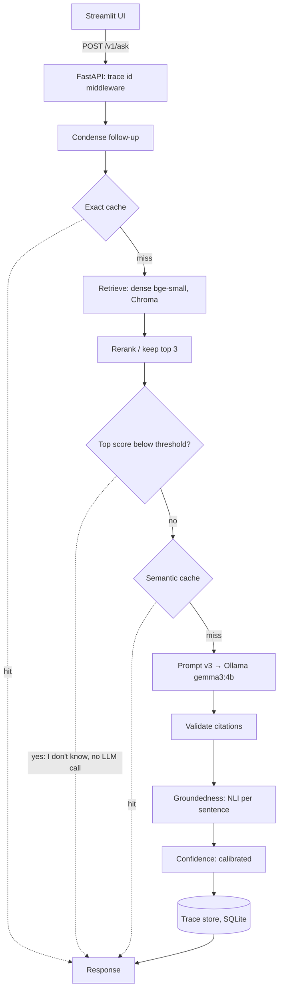

# CodeSearch AI

Question answering over the [React documentation](https://react.dev) that shows its work.
Every answer comes with sources you can check, a sentence-by-sentence support check, a
calibrated confidence score and a trace of how it was produced; questions the docs don't
cover get an honest "I don't know". Runs fully locally: a 4B model through
[Ollama](https://ollama.com), no API keys.

Ask *"How do I update state based on the previous state?"* and you get a short answer whose
`[n]` markers link to the doc sections it came from. Ask *"What's the capital of France?"*
and it declines without calling the model.

<!-- TODO: demo GIF (docs/demo.gif) -->

## What it does

- **Retrieves from 4,858 heading-aware chunks** of react.dev, embedded with
  `bge-small-en-v1.5`. Dense, BM25, hybrid (RRF) and two cross-encoder rerankers are
  implemented and compared on a golden set; dense won and is the default.
- **Abstains on off-topic questions.** If the best retrieval score is below a threshold it
  answers "I don't know" without calling the LLM: 92% of out-of-scope questions are
  declined, at the cost of declining 13% of answerable ones.
- **Cites real sources.** Invalid `[n]` markers are stripped; every kept marker maps to a
  react.dev URL.
- **Handles follow-ups.** "what about objects?" is rewritten into a standalone question
  from the chat history before retrieval and caching.
- **Caches in two tiers.** Exact matches in Redis (falls back to memory when Redis is down)
  plus a semantic tier for paraphrases that must also retrieve the same top chunk. Keys
  include the index, prompt and model versions, so a rebuild never serves stale answers.
- **Explains every answer** (next section).
- **Gates merges on quality.** CI re-runs retrieval on the golden set and blocks a PR to
  `main` if a metric drops past its tolerance.

## Explainability

| Question a user has | What answers it | Where |
|---|---|---|
| Why these sources? | A trace per answer: the standalone question, every candidate with its dense / BM25 / rerank scores, the query words each source matched, timings per step | `GET /v1/explain/{trace_id}`, "Why this answer?" in the UI |
| Is each sentence backed by its source? | An NLI model (`nli-deberta-v3-base`) scores each sentence against the source it cites: supported, partial or unsupported | Inline in the answer; `groundedness` on the response |
| How much should I trust this answer? | A calibrated probability from retrieval strength and groundedness, shown as a high / medium / low badge | `confidence` on the response |
| Which source did the answer depend on? | Leave-one-out: regenerate without each source and measure how far the answer moves (1 − cosine of embeddings), normalised to shares | `POST /v1/explain/{trace_id}/deep`, "Deep explain" in the UI (k extra LLM calls, so on demand only) |

Traces are stored in SQLite, so any answer can be explained after the fact.

## How a request flows



The pipeline is assembled in `codesearch/factory.py`, the only place that chooses
implementations; everything else receives its collaborators through Protocols, so the
test suite swaps in a fake LLM and a hash embedder and runs with no model or network.

## Results

### Retrieval

Ablation on 79 hand-written questions: 55 answerable from the docs and 24 that are not
(general knowledge, other frontend frameworks, the React ecosystem).

<!-- ablation:start -->
| Config | What it does | R@1 | R@5 | MRR | nDCG@10 | Page hit@5 | Page MRR | Pool recall | OOS abstain | False abstain |
|---|---|---:|---:|---:|---:|---:|---:|---:|---:|---:|
| v1 | v1-style chunking + dense top-3 (baseline) | n/a | n/a | n/a | n/a | 0.855 | 0.721 | n/a | **0.917** | 0.164 |
| bm25 | v2 chunking + BM25 top-10 | 0.188 | 0.479 | 0.379 | 0.405 | 0.836 | 0.642 | 0.567 | n/a | n/a |
| **dense** (default) | v2 chunking + dense top-10 | **0.345** | 0.673 | **0.574** | **0.585** | 0.982 | **0.784** | 0.752 | **0.917** | 0.127 |
| hybrid | v2 chunking + BM25/dense fused with RRF | 0.318 | 0.612 | 0.554 | 0.553 | 0.927 | 0.746 | **0.915** | **0.917** | 0.127 |
| dense_rerank | dense top-30 candidates + cross-encoder rerank | 0.282 | **0.685** | 0.555 | 0.566 | 0.982 | 0.747 | 0.888 | 0.875 | 0.036 |
| hybrid_rerank | hybrid RRF candidates + cross-encoder rerank | 0.282 | 0.636 | 0.540 | 0.557 | **1.000** | 0.729 | **0.915** | 0.875 | **0.018** |
| hybrid_rerank_bge | hybrid RRF candidates + bge-reranker-base | 0.279 | 0.615 | 0.497 | 0.527 | 0.909 | 0.680 | **0.915** | 0.875 | 0.055 |

55 in-scope questions + 24 out-of-scope from `eval/golden.jsonl`. Best value per column in bold. n/a = not measured, or not comparable (v1 chunks have no section anchors, so compare v1 on the page columns).
<!-- ablation:end -->

What the table says, and how far to trust it:

- **Dense beats hybrid and the rerankers on ranking** (R@1, MRR, nDCG). BM25 is weak on
  paraphrased questions, and fusing it in widens the candidate pool but pushes the best
  match down. The larger `bge-reranker-base` is worse than MiniLM on every ranking metric.
- **The candidate pool is not the bottleneck; ordering is.** Pool recall is ~0.9 with
  hybrid, but R@1 stays near 0.3: the right section is usually retrieved, not ranked first.
- **These differences are small.** With 55 in-scope questions, one question moves MRR by
  about 0.02, so dense vs hybrid (0.574 vs 0.554) is roughly one question. Confidence
  intervals and a larger golden set are next.
- **The v1 row is not a clean baseline.** It retrieves 3 chunks (so "hit@5" is really
  hit@3) and uses fixed 1,000-character cuts, while the original v1 split by headers with
  overlap. Read the v1 → v2 gap as an upper bound until the baseline is re-run at equal k
  with v1's real splitter.
- **Abstention numbers are optimistic.** The threshold (0.755) was tuned on the same 24
  out-of-scope questions it is reported on, and the same cosine-tuned value is applied to
  cross-encoder scores, so the reranker rows sit at a different operating point. Their
  lower false-abstain rate is a lead to follow up, not a like-for-like win.

Metrics: section-level recall@k, MRR and nDCG@10 against labelled section anchors;
page-level variants for comparison with v1, whose chunks have no anchors.

### Answer quality

The answer eval asks all 79 golden questions through the full pipeline (gemma3:4b via
Ollama, NLI judge `nli-deberta-v3-base`) and checks every sentence against its source:

| Metric | Value | |
|---|---:|---|
| Out-of-scope questions declined | 92% | 22 of 24 |
| In-scope questions answered | 87% | the cost of the abstain threshold above |
| Groundedness | 0.57 | share of sentences supported by the source they cite |
| Supported by some source | 0.64 | the gap (7%) is true claims citing the wrong source |
| Citation precision | 0.66 | share of cited pages that are a right page |
| Answers citing a right page | 81% | |
| Latency | 5.8 s p50 / 12.8 s p95 | fully local, MacBook Air |

How it got there, one change at a time (first 10 questions):

| Change | Groundedness | Citation precision | Latency p50 |
|---|---:|---:|---:|
| Baseline: 5 sources, prompt v1 | 0.50 | 0.50 | 10.5 s |
| 3 sources + prompt v2 (one citation per claim, code for "how do I") | 0.38 | 0.68 | 6.1 s |
| Eval fix: a lone trailing `[3]` was being graded as a sentence | 0.48 | 0.68 | 5.6 s |
| NLI judge `deberta-v3-small` → `deberta-v3-base` | 0.63 | 0.68 | 6.6 s |

The dip in row 2 was the eval, not the answers: each answer ended with a stray citation
that counted as an unsupported claim. The judge swap mattered most: the small model
scored near-verbatim quotes of the docs as unsupported, which also hid real mis-citations.
The judge is itself a model; comparing it with an LLM judge and hand labels is on the
roadmap.

### Confidence

A logistic regression over three features (top retrieval score, mean of the top 3,
groundedness) predicts whether an answer is good (cites a right page and is at least half
grounded). Checked out-of-fold, so no answer is scored by a model that saw it:


On the 48 answered questions, low-confidence answers were never good and high-confidence
answers were good 79% of the time. ECE is 0.13; with ~50 answers a single answer moves a
bin by up to 50%, so read the bins together with their `n`.

## Quick start

Needs Python 3.13, [uv](https://docs.astral.sh/uv/), [Ollama](https://ollama.com) and,
optionally, Docker for Redis.

```bash
make setup                    # uv sync --all-extras + pre-commit
cp .env.example .env          # every variable is documented there
ollama pull gemma3:4b         # any local model works; set CODESEARCH_LLM__MODEL
make ingest                   # fetch react.dev at a pinned commit, build the index
docker compose up -d redis    # optional: without it the cache falls back to memory

make serve                    # API on http://localhost:8000 (OpenAPI docs at /docs)
make ui                       # chat UI on http://localhost:8501
```

Or from the terminal: `uv run codesearch ask "When should I use useEffect?"`

## Evaluation

```bash
make eval                     # the default config (dense) → results/dense.json
make ablation                 # every config in eval/configs/, then refreshes the table above

# answer quality (needs Ollama; ~10 min for all 79 questions)
uv run python -m eval.answer_eval eval/configs/dense.yaml [--limit 10]
uv run python -m eval.fit_calibrator results/answers_dense.json   # -> models/calibrator.json
uv run python -m eval.plot_reliability                           # -> docs/reliability.png
```

- `eval/golden.jsonl`: the 79 questions, each with the doc sections that answer it, or
  marked out-of-scope by category.
- `eval/run_eval.py`: runs one config, writes `results/<name>.json` and logs to MLflow.
- `eval/compare.py`: compares a run against `eval/baseline.json`. The
  [eval-gate](.github/workflows/eval-gate.yml) workflow posts the comparison on PRs and
  fails on a regression (tolerance 0.02 for retrieval metrics, 0.05 for abstention).
- `eval/answer_eval.py`: the end-to-end answer eval; also writes one row per graded
  sentence to `results/sentences_<name>.csv` for hand labelling.
- `eval/fit_calibrator.py`: fits and checks the confidence model.

## Project layout

```
codesearch/
  ingest/       fetch react.dev, chunk by headings, build Chroma + BM25 + manifest
  retrieval/    dense / BM25 / hybrid (RRF), rerankers, abstain, condense
  generation/   versioned prompts, Ollama client, citation validation
  cache/        keys, LRU, Redis exact cache, semantic cache, tiered cache
  explain/      traces, groundedness (NLI), calibration, leave-one-out attribution
  api/          FastAPI app: /v1/ask, /v1/explain, /healthz, /readyz, /v1/index
  ui/           Streamlit app + the HTTP client it uses
  pipeline.py   the query path, step by step
eval/           golden set, metrics, runners, regression gate, ablation table
prompts/        answer.yaml, condense.yaml (versioned, fingerprinted in tests)
tests/          unit + integration tests (pytest; no model or network needed)
```

```bash
make test                     # the full suite
make lint                     # ruff + ruff format + mypy --strict
```

## Limitations

- **Small, single-author golden set** (55 + 24 questions). Enough to catch regressions in
  CI, not to claim general accuracy.
- **A 4B local model.** Chosen for cost and privacy; answers are slower (~6 s) and weaker
  than a hosted model would give. The model is one config value.
- **Synchronous work on the event loop.** Embedding, Chroma, reranking and Redis calls are
  blocking inside an async handler, and identical concurrent questions each call the LLM.
- **The semantic cache is per process**: in memory, lost on restart, not shared between
  workers, and its 0.95 threshold has not been evaluated for false hits.
- **No streaming yet**: answers arrive whole.

## Status and roadmap

Phases 1 (retrieval, eval, API, UI) and 2 (explainability) are complete. These are
scaffolding for Phase 3 and are **not implemented yet**: `codesearch/monitoring/`,
`codesearch/api/sse.py`, `codesearch/api/background.py`, `deploy/`, `make up`, and the
`nightly-eval` and `release` workflows.

Next:

- **Evaluation:** a fair v1 baseline, bootstrap confidence intervals, a held-out split for
  the abstain threshold with one threshold per score kind, and a larger golden set.
- **Serving:** move blocking calls off the event loop, single-flight per cache key, the
  semantic cache in Redis, SSE streaming, and a committed load-test script.
- **Deployment:** a multi-stage Docker image, a compose stack, Prometheus metrics and
  drift monitoring.

## Author

**Shubham Harkare**:
[LinkedIn](https://www.linkedin.com/in/shubham-harkare/) ·
[GitHub](https://github.com/ShubhamHarkare)
