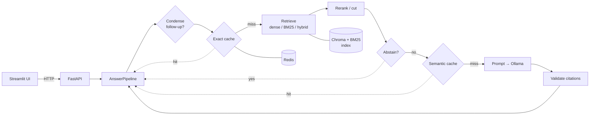

# CodeSearch AI

Question answering over the [React documentation](https://react.dev), with sources you can
check and an honest "I don't know" when the docs don't cover the question. Runs fully
locally: a local LLM through [Ollama](https://ollama.com), no API keys.

Ask *"How do I update state based on the previous state?"* and you get a short answer whose
`[n]` markers link to the exact doc sections it came from. Ask *"What's the capital of
France?"* and it declines instead of guessing.

## What it does

- **Retrieval you can measure.** 4,858 section-aware chunks from react.dev, embedded with
  `bge-small-en-v1.5`. Dense, BM25, hybrid (RRF) and cross-encoder reranking are all
  implemented; dense won the ablation below and is the default.
- **Abstains on off-topic questions.** A score threshold tuned on the golden set declines
  91.7% of out-of-scope questions while wrongly declining 12.7% of real ones. No LLM call
  is made when it abstains.
- **Citations that point somewhere real.** Invalid `[n]` markers are stripped; every kept
  marker maps to a react.dev URL.
- **Follow-up questions.** "what about objects?" is rewritten into a standalone question
  using the chat history before retrieval.
- **Two-tier cache.** Exact matches in Redis (in-memory fallback if Redis is down) plus a
  semantic tier for paraphrases. Keys include the index, prompt and model versions, so a
  new build never serves stale answers.
- **An eval gate in CI.** Every push re-runs retrieval on the golden set and fails if a
  metric drops past its tolerance.

## Results

Retrieval ablation on 79 hand-written questions: 55 answerable from the docs and 24 that
are not (general knowledge, other frontend frameworks, the React ecosystem).

<!-- ablation:start -->
| Config | What it does | R@1 | R@5 | MRR | nDCG@10 | Page hit@5 | Page MRR | Pool recall | OOS abstain | False abstain |
|---|---|---:|---:|---:|---:|---:|---:|---:|---:|---:|
| v1 | v1-style chunking + dense top-3 (baseline) | n/a | n/a | n/a | n/a | 0.855 | 0.721 | n/a | **0.917** | 0.164 |
| bm25 | v2 chunking + BM25 top-10 | 0.188 | 0.479 | 0.379 | 0.405 | 0.836 | 0.642 | 0.567 | n/a | n/a |
| **dense** (default) | v2 chunking + dense top-10 | **0.345** | 0.673 | **0.574** | **0.585** | 0.982 | **0.784** | 0.752 | **0.917** | 0.127 |
| hybrid | v2 chunking + BM25/dense fused with RRF | 0.318 | 0.612 | 0.554 | 0.553 | 0.927 | 0.746 | **0.915** | **0.917** | 0.127 |
| dense_rerank | dense top-30 candidates + cross-encoder rerank | 0.282 | **0.685** | 0.555 | 0.566 | 0.982 | 0.747 | 0.888 | 0.875 | 0.036 |
| hybrid_rerank | hybrid RRF candidates + cross-encoder rerank | 0.282 | 0.636 | 0.540 | 0.557 | **1.000** | 0.729 | **0.915** | 0.875 | **0.018** |
| hybrid_rerank_bge | hybrid RRF candidates + bge-reranker-base | 0.279 | 0.615 | 0.497 | 0.527 | 0.909 | 0.680 | **0.915** | 0.875 | 0.055 |

55 in-scope questions + 24 out-of-scope from `eval/golden.jsonl`. Best value per column in bold. n/a = not measured, or not comparable (v1 chunks have no section anchors, so compare v1 on the page columns).
<!-- ablation:end -->

What the table says:

- **v1 → v2 chunking** is the biggest win: splitting by headings instead of every 1,000
  characters puts the right *page* in the top 5 for 98% of questions instead of 86%.
- **Dense beats hybrid.** BM25 alone is weak on paraphrased questions; fusing it in widens
  the candidate pool but pushes the best match down the list.
- **Rerankers raise R@5 but lower R@1 and MRR.** The candidate pool already contains the
  answer ~90% of the time (pool recall), so ordering, not recall, is the bottleneck, and
  a MS MARCO cross-encoder doesn't order React docs better than the embedder does. The
  larger `bge-reranker-base` is worse than MiniLM on every ranking metric.
- **But rerankers are much better at abstaining.** Cross-encoder scores separate React
  questions from off-topic ones far more cleanly than embedding similarity: with
  `hybrid_rerank`, only 1.8% of real questions are wrongly declined, against 12.7% with
  dense. Dense stays the default for ranking quality; a reranker as the abstain signal is
  the next thing to try.

Metrics: section-level recall@k, MRR and nDCG@10 against the labelled section anchors;
page-level variants for comparison with v1, whose chunks have no anchors.

## Architecture



The pipeline is assembled in `codesearch/factory.py`, the only place that chooses
implementations; everything else receives its collaborators, so tests swap in a fake
LLM and a hash embedder and run in seconds.

## Quick start

Needs Python 3.13, [uv](https://docs.astral.sh/uv/), [Ollama](https://ollama.com) and
Docker (for Redis, optional).

```bash
make setup                    # uv sync --all-extras + pre-commit
cp .env.example .env
ollama pull gemma3:4b         # any local model works; set CODESEARCH_LLM__MODEL
make ingest                   # fetch react.dev at a pinned commit and build the index
docker compose up -d redis    # optional: without it the cache falls back to memory

make serve                    # API on http://localhost:8000 (docs at /docs)
make ui                       # chat UI on http://localhost:8501
```

Or from the terminal: `uv run codesearch ask "When should I use useEffect?"`

## Evaluation

```bash
make eval                     # the default config (dense) → results/dense.json
make ablation                 # every config in eval/configs/, then refreshes the table above
```

- `eval/golden.jsonl`: the 79 questions, each with the doc sections that answer it (or
  marked out-of-scope by category).
- `eval/run_eval.py`: runs one config, writes `results/<name>.json` and logs to MLflow.
- `eval/compare.py`: compares a run against `eval/baseline.json`; the
  [eval-gate](.github/workflows/eval-gate.yml) workflow posts the comparison on PRs and
  fails on a regression (tolerance 0.02 for retrieval metrics, 0.05 for abstention).

## Project layout

```
codesearch/
  ingest/       fetch react.dev, chunk by headings, build Chroma + BM25 + manifest
  retrieval/    dense / BM25 / hybrid (RRF), rerankers, abstain, condense
  generation/   versioned prompts, Ollama client, citation validation
  cache/        keys, LRU, Redis exact cache, semantic cache, tiered cache
  api/          FastAPI app: /v1/ask, /healthz, /readyz, /v1/index
  ui/           Streamlit app + the HTTP client it uses
  pipeline.py   the query path, step by step
eval/           golden set, metrics, runner, regression gate, ablation table
prompts/        answer.yaml, condense.yaml (versioned, fingerprinted)
tests/          unit + integration tests (pytest; no model or network needed)
```

```bash
make test                     # the full suite
make lint                     # ruff + ruff format + mypy --strict
```

## Roadmap

- **Explainability:** a "why this answer?" panel with per-source scores, sentence-level
  groundedness and a calibrated confidence score.
- **Streaming** answers over SSE, incremental re-indexing when the docs change, user
  feedback.
- **Deployment:** Docker images, Prometheus metrics and drift monitoring.

## Author

**Shubham Harkare**:
[LinkedIn](https://www.linkedin.com/in/shubham-harkare/) ·
[GitHub](https://github.com/ShubhamHarkare)
