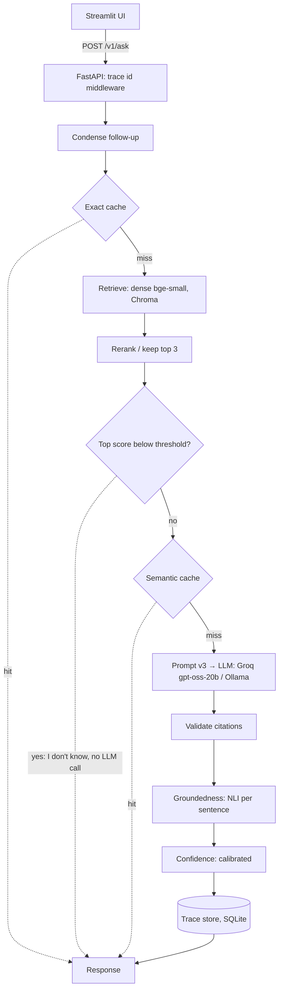
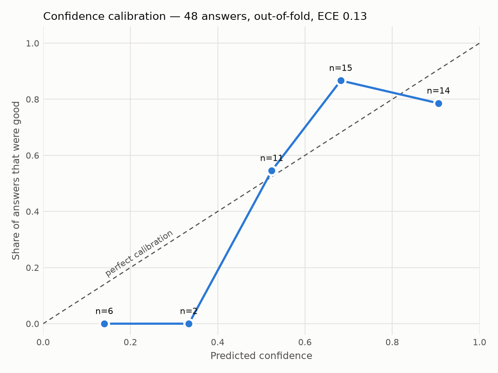

# CodeSearch AI

Question answering over the [React documentation](https://react.dev) that shows its work.
Every answer comes with sources you can check, a sentence-by-sentence support check, a
calibrated confidence score and a trace of how it was produced; questions the docs don't
cover get an honest "I don't know". Runs as one Docker stack (API, UI, Redis, Prometheus,
Grafana) with `make up`. The LLM is any OpenAI-compatible API (Groq `gpt-oss-20b` by
default) or a local model through [Ollama](https://ollama.com).

Ask *"How do I update state based on the previous state?"* and you get a short answer whose
`[n]` markers link to the doc sections it came from. Ask *"What's the capital of France?"*
and it declines without calling the model.

## What it does

- **Retrieves from 4,858 heading-aware chunks** of react.dev, embedded with
  `bge-small-en-v1.5`. Dense, BM25, hybrid (RRF) and two cross-encoder rerankers are
  implemented and compared on a golden set; dense won and is the default.
- **Abstains on off-topic questions.** If the best retrieval score is below a threshold it
  answers "I don't know" without calling the LLM: 92% of out-of-scope questions are
  declined, at the cost of declining 13% of answerable ones.
- **Cites real sources.** Invalid `[n]` markers are stripped; every kept marker maps to a
  react.dev URL.
- **Handles follow-ups.** "what about objects?" is rewritten into a standalone question
  from the chat history before retrieval and caching.
- **Caches in two tiers.** Exact matches in Redis (falls back to memory when Redis is down)
  plus a semantic tier for paraphrases that must also retrieve the same top chunk. Keys
  include the index, prompt and model versions, so a rebuild never serves stale answers.
- **Streams answers.** `POST /v1/ask/stream` sends the sources first, then the answer
  token by token (server-sent events): first words in 0.33 s on Groq (1.8 s on a local
  4B model). Closing the tab stops the model mid-answer and caches nothing.
- **Shares identical in-flight questions.** Ten users asking the same new question at
  once trigger one LLM call; the other nine wait for it (single-flight per cache key).
- **Stays current.** A signed webhook (or a timer) rebuilds only the chunks that changed
  into a new build folder, then switches the live index atomically: a request never sees
  half an old index and half a new one.
- **Watches itself.** Prometheus metrics (latency, first-token time, cache hit rate,
  abstain rate, groundedness, query drift against the golden set, thumbs up/down) on a
  provisioned Grafana dashboard, with alerts for falling groundedness, drift and LLM rate
  limits. Questions it couldn't answer are clustered into topics (`GET /v1/admin/gaps`).
- **Fails politely.** When the hosted LLM's quota runs out, users get "busy, try again"
  (HTTP 429), the eval waits and retries, and cached answers keep being served.
- **Explains every answer** (next section).
- **Gates merges on quality.** CI re-runs retrieval on the golden set and blocks a PR to
  `main` if a metric drops past its tolerance.

## Explainability

| Question a user has | What answers it | Where |
|---|---|---|
| Why these sources? | A trace per answer: the standalone question, every candidate with its dense / BM25 / rerank scores, the query words each source matched, timings per step | `GET /v1/explain/{trace_id}`, "Why this answer?" in the UI |
| Is each sentence backed by its source? | An NLI model (`nli-deberta-v3-base`) scores each sentence against the source it cites: supported, partial or unsupported | Inline in the answer; `groundedness` on the response |
| How much should I trust this answer? | A calibrated probability from retrieval strength and groundedness, shown as a high / medium / low badge | `confidence` on the response |
| Which source did the answer depend on? | Leave-one-out: regenerate without each source and measure how far the answer moves (1 − cosine of embeddings), normalised to shares | `POST /v1/explain/{trace_id}/deep`, "Deep explain" in the UI (k extra LLM calls, so on demand only) |

Traces are stored in SQLite, so any answer can be explained after the fact.

## How a request flows



The pipeline is assembled in `codesearch/factory.py`, the only place that chooses
implementations; everything else receives its collaborators through Protocols, so the
test suite swaps in a fake LLM and a hash embedder and runs with no model or network.

## Results

### Retrieval

Ablation on 79 hand-written questions: 55 answerable from the docs and 24 that are not
(general knowledge, other frontend frameworks, the React ecosystem).

<!-- ablation:start -->
| Config | What it does | R@1 | R@5 | MRR | nDCG@10 | Page hit@5 | Page MRR | Pool recall | OOS abstain | False abstain |
|---|---|---:|---:|---:|---:|---:|---:|---:|---:|---:|
| v1 | v1 chunking (headings, then 1,000-char recursive split, 150 overlap) + dense top-10 | 0.330 | 0.648 | 0.556 | 0.569 | 0.873 | 0.705 | 0.745 | 0.833 | 0.109 |
| bm25 | v2 chunking + BM25 top-10 | 0.188 | 0.479 | 0.379 | 0.405 | 0.836 | 0.642 | 0.567 | n/a | n/a |
| **dense** (default) | v2 chunking + dense top-10 | **0.345** | 0.673 | **0.574** | **0.585** | 0.982 | **0.784** | 0.752 | **0.917** | 0.127 |
| hybrid | v2 chunking + BM25/dense fused with RRF | 0.318 | 0.612 | 0.554 | 0.553 | 0.927 | 0.746 | **0.915** | **0.917** | 0.127 |
| dense_rerank | dense top-30 candidates + cross-encoder rerank | 0.282 | **0.685** | 0.555 | 0.566 | 0.982 | 0.747 | 0.888 | 0.875 | 0.036 |
| hybrid_rerank | hybrid RRF candidates + cross-encoder rerank | 0.282 | 0.636 | 0.540 | 0.557 | **1.000** | 0.729 | **0.915** | 0.875 | **0.018** |
| hybrid_rerank_bge | hybrid RRF candidates + bge-reranker-base | 0.279 | 0.615 | 0.497 | 0.527 | 0.909 | 0.680 | **0.915** | 0.875 | 0.055 |

55 in-scope questions + 24 out-of-scope from `eval/golden.jsonl`. Best value per column in bold. n/a = not measured for that config.
<!-- ablation:end -->

What the table says, and how far to trust it:

- **Dense beats hybrid and the rerankers on ranking** (R@1, MRR, nDCG). BM25 is weak on
  paraphrased questions, and fusing it in widens the candidate pool but pushes the best
  match down. The larger `bge-reranker-base` is worse than MiniLM on every ranking metric.
- **The candidate pool is not the bottleneck; ordering is.** Pool recall is ~0.9 with
  hybrid, but R@1 stays near 0.3: the right section is usually retrieved, not ranked first.
- **These differences are small.** With 55 in-scope questions, one question moves MRR by
  about 0.02, so dense vs hybrid (0.574 vs 0.554) is roughly one question. Confidence
  intervals and a larger golden set are next.
- **v1 → v2 chunking helps you find the right page, not the right section.** The v1 row
  re-implements the original app's chunking (heading split, then a recursive 1,000-char
  split with 150 overlap) and keeps everything else equal to `dense`. v2 puts the right
  page in the top 5 for 98% of questions vs 87% (6 more of 55), but section-level R@1,
  R@5 and MRR move by about one question. A likely reason: v2 starts every chunk with its
  "Page > Section" path, so the embedding knows which page it came from.
- **Abstention numbers are optimistic.** The threshold (0.755) was tuned on the same 24
  out-of-scope questions it is reported on, and the same value is applied to every row,
  so v1 and the reranker rows sit at different operating points. Their
  lower false-abstain rate is a lead to follow up, not a like-for-like win.

Metrics: section-level recall@k, MRR and nDCG@10 against labelled section anchors, plus
page-level hit@5 and MRR.

### Answer quality

The answer eval asks all 79 golden questions through the full pipeline (gemma3:4b via
Ollama, NLI judge `nli-deberta-v3-base`) and checks every sentence against its source:

| Metric | Value | |
|---|---:|---|
| Out-of-scope questions declined | 92% | 22 of 24 |
| In-scope questions answered | 87% | the cost of the abstain threshold above |
| Groundedness | 0.57 | share of sentences supported by the source they cite |
| Supported by some source | 0.64 | the gap (7%) is true claims citing the wrong source |
| Citation precision | 0.66 | share of cited pages that are a right page |
| Answers citing a right page | 81% | |
| Latency | 5.8 s p50 / 12.8 s p95 | fully local, MacBook Air |

How it got there, one change at a time (first 10 questions):

| Change | Groundedness | Citation precision | Latency p50 |
|---|---:|---:|---:|
| Baseline: 5 sources, prompt v1 | 0.50 | 0.50 | 10.5 s |
| 3 sources + prompt v2 (one citation per claim, code for "how do I") | 0.38 | 0.68 | 6.1 s |
| Eval fix: a lone trailing `[3]` was being graded as a sentence | 0.48 | 0.68 | 5.6 s |
| NLI judge `deberta-v3-small` → `deberta-v3-base` | 0.63 | 0.68 | 6.6 s |

The dip in row 2 was the eval, not the answers: each answer ended with a stray citation
that counted as an unsupported claim. The judge swap mattered most: the small model
scored near-verbatim quotes of the docs as unsupported, which also hid real mis-citations.
The judge is itself a model; comparing it with an LLM judge and hand labels is on the
roadmap.

### Which model: a local 4B vs a hosted 20B

The same pipeline, prompt and judge with two models (all 79 questions):

| | gemma3:4b (Ollama, laptop) | gpt-oss-20b (Groq) |
|---|---:|---:|
| In-scope questions answered | 87% | 84% |
| Out-of-scope questions declined | 92% | 100% |
| Citation precision | 0.66 | 0.70 |
| Answers citing a right page | 81% | 74% |
| **Sentences carrying their own `[n]`** | **87%** | **45%** |
| Groundedness | **0.57** | **0.09** |
| Latency p50 / p95 | 5.8 s / 12.8 s | **1.1 s / 1.8 s** |

The bigger model cites the right pages about as well, but **ignores the per-sentence
citation rule**: it often puts one `[2]` after the whole answer, so most sentences have no
source to check and grade as unsupported. With more reasoning (`reasoning_effort=medium`,
15 questions) 45% of its sentences are supported by *some* retrieved source, yet 35% cite
the wrong one: the content is mostly fine, the attribution isn't. A prompt with a worked
example of per-sentence citations is the next experiment. The deployed default is still
gpt-oss-20b, for its speed and a free quota that isn't shared with other users (free
hosted Gemma endpoints were rate-limited by their shared pool).

The point for the eval: a 5× bigger model looked fine when reading answers, and only the
per-sentence check showed that its citations could not be trusted.

### Confidence

A logistic regression over three features (top retrieval score, mean of the top 3,
groundedness) predicts whether an answer is good (cites a right page and is at least half
grounded). Checked out-of-fold, so no answer is scored by a model that saw it:



On the 48 answered questions, low-confidence answers were never good and high-confidence
answers were good 79% of the time. ECE is 0.13; with ~50 answers a single answer moves a
bin by up to 50%, so read the bins together with their `n`.

The shipped calibrator is this gemma3:4b fit. Refitting on gpt-oss-20b gave 2 good
answers out of 46, too few to learn from, so with gpt-oss the badge mostly reads low or
medium until its citations improve.

### Serving performance

`eval/loadtest.py` against the API, in two setups. Every figure is re-runnable, and the
raw reports are in [`docs/loadtest/`](docs/loadtest/) (local) and
[`docs/loadtest/docker-groq/`](docs/loadtest/docker-groq/) (Docker).

| Scenario | Local: Ollama gemma3:4b, `make serve` | Docker stack: Groq gpt-oss-20b |
|---|---|---|
| Cache hits, 50 concurrent | 291 req/s, p50 94 ms, p99 960 ms | 187 req/s, p50 141 ms, p99 1.6 s |
| Cache hits while 4 answers generate | p50 9 ms, p99 26 ms | p50 9 ms, **p99 1.28 s** |
| New question, 1 user, streamed | first words p50 1.8 s, total 4.2 s | first words **p50 0.33 s**, total 0.6 s |
| New questions, 4 users, streamed | first words p50 10.2 s | first words p50 0.72 s; **7 of 10 rate-limited** |
| 20 new questions, 4 at a time | all answered, queued | **15 of 20 refused (HTTP 429)** |
| 10 identical new questions at once | 1 LLM call (was 10), 6.9 s (was 32 s) | 1 LLM call, 0.61 s |

What changed between the two columns:

- **The bottleneck moved from compute to quota.** Locally, one laptop model generates one
  answer at a time, so new questions queue but all get answered. Groq answers 5× faster,
  but its free tier caps tokens per minute, and every one of the 28 failures in the Docker
  runs was a rate limit (the API logs one line per refusal), not an error. Users got
  "busy, try again"; cached answers kept flowing at 187 req/s; single-flight turned the
  10-question burst into one call. More users would need a paid tier or a second
  provider, not more code.
- **A stall the slow model was hiding.** Cache hits need no model, yet while new answers
  were being checked they slowed to p99 1.28 s (26 ms locally). Retrieval, reranking and
  the NLI check are synchronous calls inside async handlers, so they block the event loop.
  With a slow LLM most of a request was spent awaiting the model, which hid the problem;
  with Groq answering in 0.3 s the CPU-bound NLI check dominates. The fix (run them in
  `asyncio.to_thread`) is the first item on the roadmap.
- **Docker Desktop on macOS adds latency** to every request (port forwarding through its
  VM), which accounts for most of the drop in cache-hit throughput; on a Linux host it
  mostly goes away.

## Quick start

### Docker (the whole stack)

Needs Docker and an LLM key (a free [Groq](https://console.groq.com) key works).

```bash
cp .env.example .env          # set CODESEARCH_LLM__API_KEY and GRAFANA_ADMIN_PASSWORD
make index                    # first run: builds the image, fetches react.dev, builds the index
make up                       # API, UI, Redis, Prometheus, Grafana

# chat UI   http://localhost:8501
# Grafana   http://localhost:3000   (admin / your GRAFANA_ADMIN_PASSWORD)
# API       http://localhost:8000   (OpenAPI docs at /docs)
make logs                     # follow the API; `make down` stops everything
```

The image is multi-stage, runs as a non-root user and has the embedding and NLI models
baked in, so containers start without downloading anything; the models are loaded before
the API accepts its first request. The index, traces and feedback live in volumes.

### Local development

Needs Python 3.13 and [uv](https://docs.astral.sh/uv/); for a fully local LLM,
[Ollama](https://ollama.com) (`CODESEARCH_LLM__PROVIDER=ollama`, model `gemma3:4b`).

```bash
make setup                    # uv sync --all-extras + pre-commit
cp .env.example .env          # every variable is documented there
make ingest                   # fetch react.dev at a pinned commit, build the index

make serve                    # API on http://localhost:8000 (OpenAPI docs at /docs)
make ui                       # chat UI on http://localhost:8501
```

Or from the terminal: `uv run codesearch ask "When should I use useEffect?"`, or watch an
answer stream:

```bash
curl -N -X POST localhost:8000/v1/ask/stream -H 'Content-Type: application/json' \
     -d '{"question": "When should I use useEffect?"}'
```

## Evaluation

```bash
make eval                     # the default config (dense) → results/dense.json
make ablation                 # every config in eval/configs/, then refreshes the table above

# answer quality (~10-30 min for all 79 questions)
uv run python -m eval.answer_eval eval/configs/dense.yaml [--limit 10]
#   --tag gpt-oss-20b   keep each model's results side by side
#   --pause 10          space out questions for a free-tier quota (429s are retried)
uv run python -m eval.fit_calibrator results/answers_dense.json   # -> models/calibrator.json
uv run python -m eval.plot_reliability                           # -> docs/reliability.png

# serving performance (needs the API running: `make serve` or `make up`)
make loadtest                 # hit, miss, burst, mixed, stream -> docs/loadtest/*.json
```

- `eval/golden.jsonl`: the 79 questions, each with the doc sections that answer it, or
  marked out-of-scope by category.
- `eval/run_eval.py`: runs one config, writes `results/<name>.json` and logs to MLflow.
- `eval/compare.py`: compares a run against `eval/baseline.json`. The
  [eval-gate](.github/workflows/eval-gate.yml) workflow posts the comparison on PRs and
  fails on a regression (tolerance 0.02 for retrieval metrics, 0.05 for abstention).
- `eval/answer_eval.py`: the end-to-end answer eval; also writes one row per graded
  sentence to `results/sentences_<name>.csv` for hand labelling.
- `eval/fit_calibrator.py`: fits and checks the confidence model.

## Project layout

```
codesearch/
  ingest/       fetch react.dev, chunk by headings, build Chroma + BM25 + manifest
  retrieval/    dense / BM25 / hybrid (RRF), rerankers, abstain, condense
  generation/   versioned prompts, LLM clients (OpenAI-compatible, Ollama), citations
  cache/        keys, LRU, Redis exact cache, semantic cache, tiered cache, single-flight
  explain/      traces, groundedness (NLI), calibration, leave-one-out attribution
  monitoring/   rolling windows, Prometheus metrics, query drift, content gaps, feedback
  api/          FastAPI app, SSE streaming, background re-indexing, signed webhook
  ui/           Streamlit app + the HTTP client it uses
  pipeline.py   the query path, step by step
  warmup.py     loads the models at startup
eval/           golden set, metrics, runners, regression gate, ablation, load test
prompts/        answer.yaml, condense.yaml (versioned, fingerprinted in tests)
deploy/         Dockerfile, docker-compose.yml, Prometheus config + alerts, Grafana
tests/          unit + integration tests (pytest; no model or network needed)
```

```bash
make test                     # the full suite
make lint                     # ruff + ruff format + mypy --strict
```

## Limitations

- **Small, single-author golden set** (55 + 24 questions). Enough to catch regressions in
  CI, not to claim general accuracy.
- **Blocking work on the event loop.** Embedding, Chroma, reranking and the NLI check are
  synchronous calls inside async handlers: with Groq, cache hits stall to p99 1.28 s
  while new answers are being checked. Fix: run them in `asyncio.to_thread`. The Redis
  client is synchronous too, which queues cache hits at high concurrency.
- **The free LLM quota is the capacity limit.** About five new answers per burst before
  Groq refuses with 429s; handled gracefully, but not a production capacity.
- **gpt-oss-20b's citations.** It cites far fewer sentences than the prompt asks for, so
  groundedness is low with the deployed model (see the model comparison).
- **One process holds the state.** Single-flight, the semantic cache, the metrics window
  and drift are per process, and traces and feedback are SQLite files: the stack runs one
  API worker. Scaling out needs these moved to shared stores (Redis, a database).
- **Not deployed publicly.** The stack runs anywhere Docker does; there is no hosted
  instance, and the UI has no authentication or per-user rate limit yet.

## Status and roadmap

Phases 1 (retrieval, eval, API, UI), 2 (explainability) and 3 (streaming, single-flight,
re-indexing, monitoring, feedback, Docker stack) are complete.

Next:

- **Serving:** blocking calls in threads (the measured stall above), an async Redis
  client, and shared state (single-flight lock and semantic cache in Redis, traces in a
  database) so the API can run as several instances behind a load balancer.
- **Answers:** a prompt that gets gpt-oss to cite per sentence, then refit the calibrator.
- **Evaluation:** bootstrap confidence intervals, a held-out split for the abstain
  threshold, a larger golden set, and an LLM judge compared against the NLI judge.
- **Deployment:** a public instance with authentication and per-user rate limits; CI that
  builds and publishes the image.

## Author

**Shubham Harkare**:
[LinkedIn](https://www.linkedin.com/in/shubham-harkare/) ·
[GitHub](https://github.com/ShubhamHarkare)
